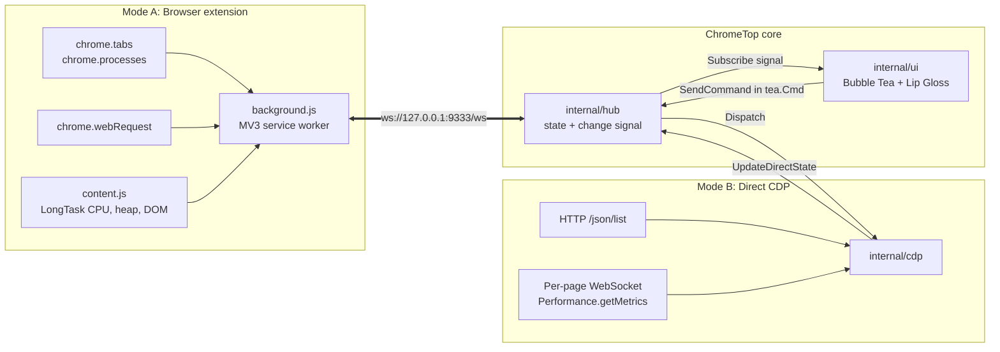
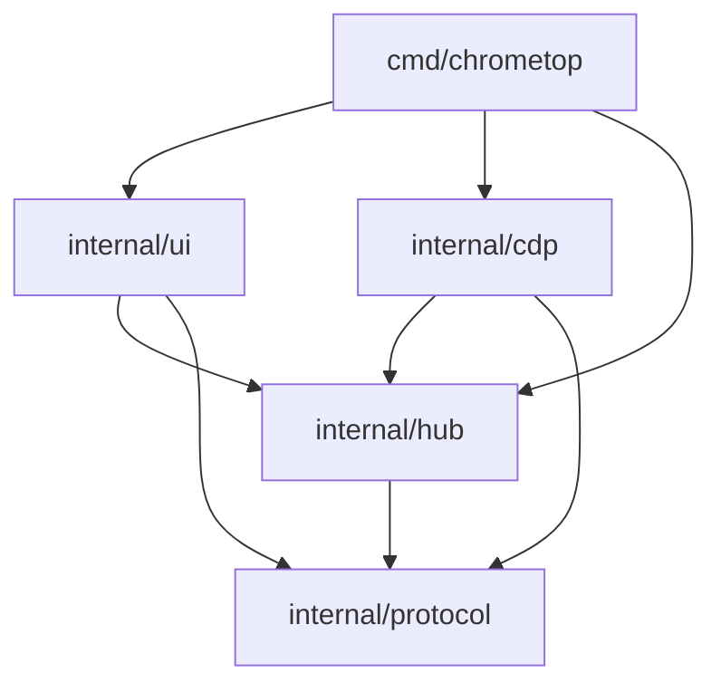
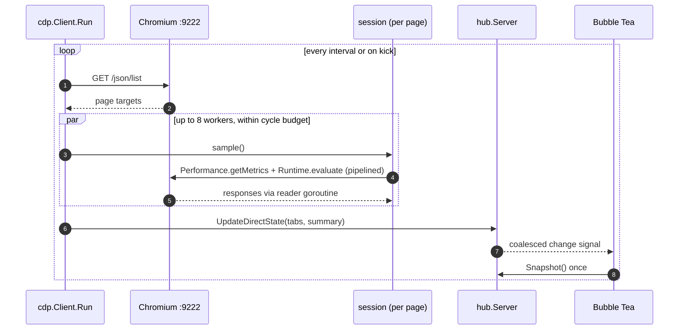
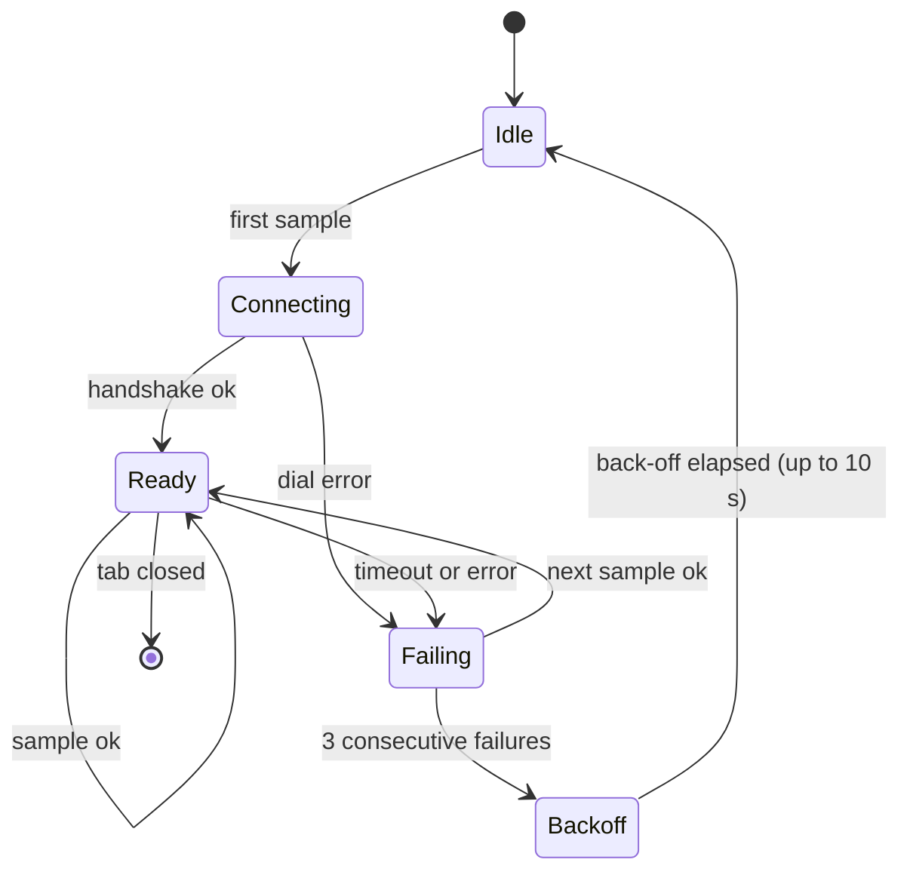
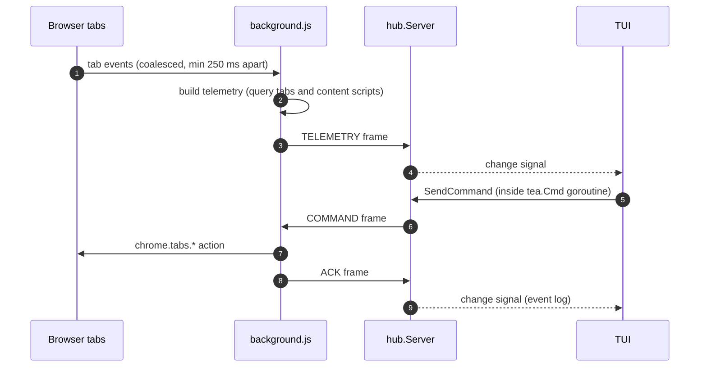
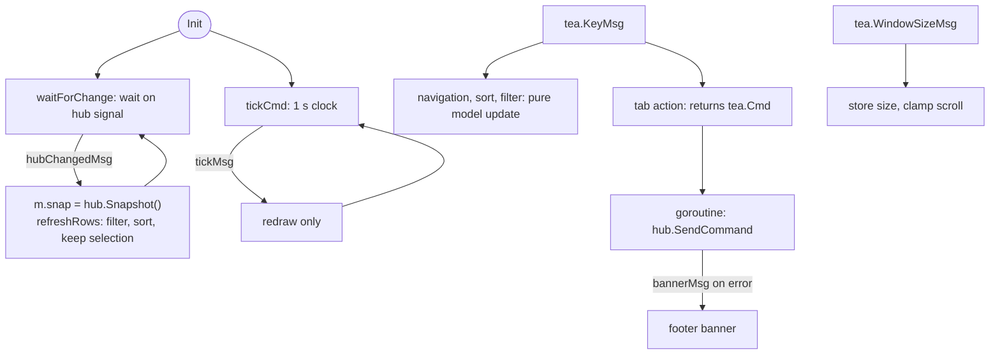
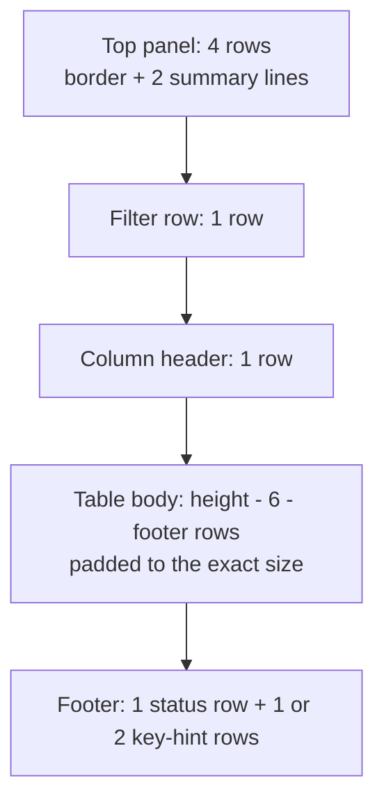

# 🏗️ ChromeTop Architecture

ChromeTop has two interchangeable telemetry backends that feed one thread-safe state store (the **hub**), which the Bubble Tea UI renders.

## 1. Component overview

## 2. Package dependencies

`protocol` has no dependencies. `hub` knows nothing about the UI or CDP: it only stores state and signals subscribers.

## 3. CDP polling cycle

One goroutine (`Client.Run`) owns polling, so cycles never overlap. Each cycle has a hard time budget, and pages that do not answer in time keep their last known values.

### Session lifecycle

## 4. Extension telemetry and commands

## 5. UI event loop

The model is updated only by messages. Nothing in `Update` or `View` blocks.

## 6. Layout engine

The terminal height is split exactly, so no rows are left over.

Rules that keep the frame exactly `height` rows tall and at most `width` cells wide:

- Footer height comes from the real wrapped key hints, not from a constant.
- Every line is truncated to the available width with an ANSI-aware, wide-character-aware function. Nothing wraps unexpectedly.
- Table cells are padded by **display width**. Emoji and CJK text count as two cells, so columns stay aligned.
- `fitHeight` pads or cuts the final frame to exactly `height` lines.

## 7. Why the UI used to freeze (and the fixes)

| Root cause | Effect | Fix |
| :--- | :--- | :--- |
| Hub change callback sent `TickMsg`, and every `TickMsg` scheduled a *new* 1 s tick | Tick chains multiplied with every update, so redraw rate grew over time | One tick chain; hub changes use a separate message and a coalescing channel |
| `Dispatch` (HTTP and WebSocket I/O, up to seconds) ran inside `Update` | UI froze on every action | Commands run inside `tea.Cmd` goroutines |
| `Dispatch` and the `SYNC` key ran a full poll synchronously | Multi-second stalls | They call `kick()`, and the poll loop refreshes asynchronously |
| Hub callback called `Program.Send` from the same goroutine that runs `Update` | Possible deadlock | Hub never calls into the UI; it only signals a buffered channel |
| `View` copied and re-sorted state on every frame | Wasted CPU with many tabs | Snapshot and sort once per hub change |
| Sequential page sampling with per-read deadlines on a shared socket | One slow page stalled the cycle and corrupted the socket | Reader goroutine per page, request IDs, per-cycle time budget, back-off |
| Any failed poll blanked the table | Flicker | Last known tabs stay until 3 consecutive failures |

## 8. Concurrency model

| Component | Goroutines | Shared state | Protection |
| :--- | :--- | :--- | :--- |
| Hub | WebSocket handler, heartbeat | tabs, summary, log, revision | `sync.RWMutex` |
| CDP client | `Run` loop, up to 8 samplers per cycle, one reader per page | sessions, tab IDs | `sync.Mutex` |
| CDP session | reader goroutine, sampler, dispatcher | connection, pending requests | `mu`, `writeMu`, `dialMu` |
| UI | Bubble Tea loop, short-lived command goroutines | model (value type) | confined to the loop |

## 9. Design decisions

- **Passive hub.** Backends push state in, the UI pulls it out. Neither side can block the other.
- **Coalescing notifications.** A buffered channel of capacity 1 means producers never block and bursts collapse into one redraw.
- **Reader goroutine per CDP page.** `gorilla/websocket` leaves a connection unusable after a read deadline expires. A dedicated reader with ID-matched responses removes that failure mode.
- **Graceful degradation.** Slow or stuck pages show stale values and back off instead of stalling everyone.
