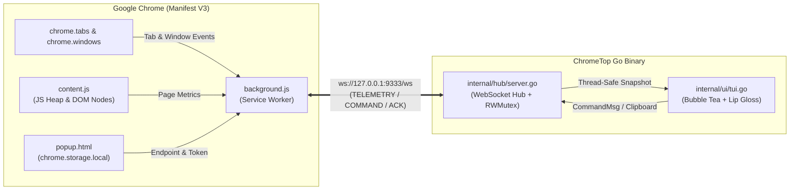
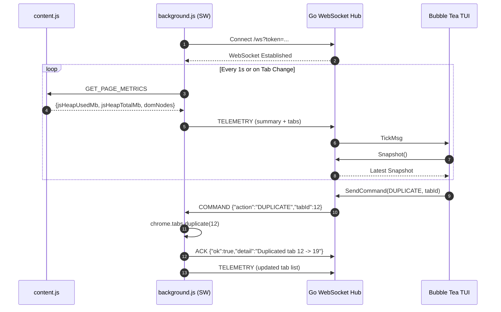

# 🏗️ ChromeTop Architecture

## Overview

ChromeTop decouples browser telemetry collection and tab actuation from terminal rendering using a local JSON-over-WebSocket bridge:

1. **Chrome Extension (`extension/`):**
   - `background.js` (MV3 Service Worker) aggregates tab and window state via `chrome.tabs` and `chrome.windows`, queries page-level metrics from `content.js`, maintains a persistent WebSocket connection with auto-reconnect and keepalive alarms, and executes control commands (`FOCUS`, `CLOSE`, `RELOAD`, `DISCARD`, `MUTE`, `PIN`, `DUPLICATE`, `NEW_TAB`, `SYNC`).
   - `content.js` reads `performance.memory` (when exposed by Chrome) and DOM node counts on HTTP/HTTPS pages.
   - `popup.html` stores WebSocket endpoint and token settings in `chrome.storage.local`.
2. **Go Hub & TUI (`cmd/chrometop`, `internal/`):**
   - `internal/hub/server.go` hosts the WebSocket endpoint (`/ws`), validates optional auth tokens and `chrome-extension://` origins, runs ping/pong heartbeats, and exposes thread-safe snapshots via `sync.RWMutex`.
   - `internal/ui/tui.go` renders the Bubble Tea + Lip Gloss interface, handling navigation, filtering, sorting, tab inspection, clipboard copy, and command dispatch.

---

## Component & Data Flow Diagram

---

## Command & Telemetry Sequence Diagram

