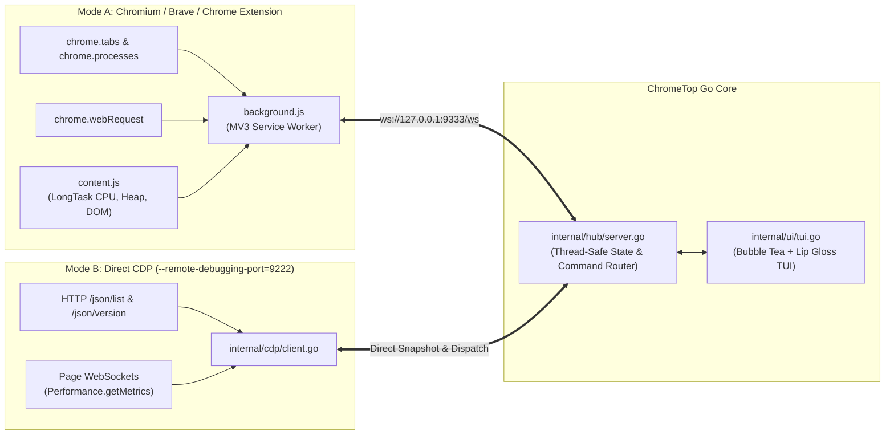
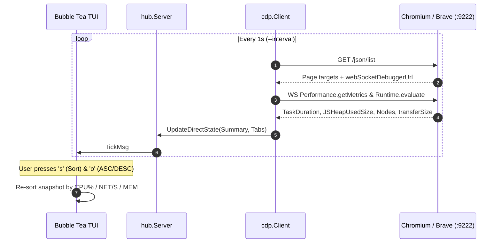

# 🏗️ ChromeTop Architecture

## Dual-Mode Telemetry & Control Design

ChromeTop supports both **Extension Mode** (WebSocket server in Go, client in Chromium/Brave/Chrome MV3 extension) and **Direct CDP Mode** (`--cdp`, WebSocket client in Go connecting to Chromium's `--remote-debugging-port` endpoints). Both backends feed the same thread-safe `hub.Server` state snapshot consumed by the Bubble Tea TUI.

---

## Architecture Diagram

---

## Data Flow: Direct CDP Mode (`--cdp`)

