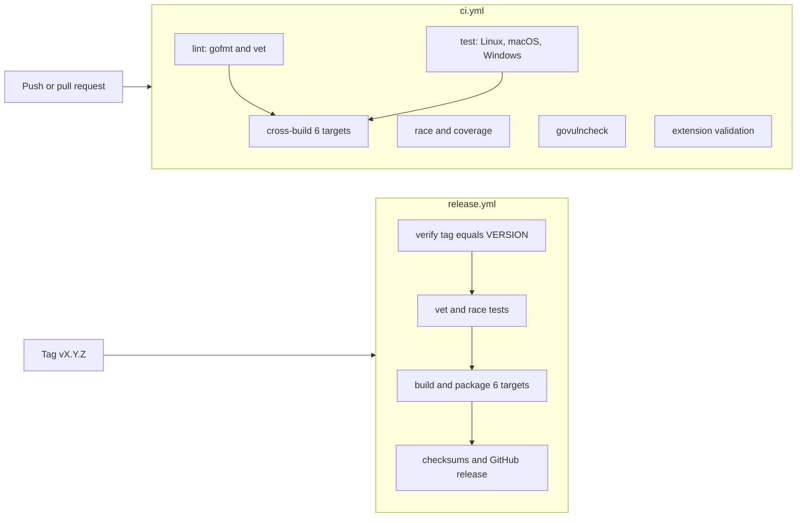

# Development Guide

## Requirements

- Go 1.24 or newer
- `make` (Linux/macOS) or PowerShell (Windows)
- Node.js 22 (optional, only to syntax-check the extension)

## Common tasks

| Task | Command |
| :--- | :--- |
| Format | `make fmt` |
| Vet | `make vet` |
| Test | `make test` |
| Test with race detector | `make race` |
| Coverage summary | `make cover` |
| Build | `make build` |
| Cross-compile all platforms | `make dist` |
| Package the extension | `make ext-zip` |

Run `make all` before every commit. CI rejects code that is not `gofmt`-formatted.

## Tests

| Package | What is covered |
| :--- | :--- |
| `internal/ui` | Exact frame height and width at many sizes, footer position, selection stability, non-blocking commands, single tick chain, sanitizing |
| `internal/cdp` | Polling against a fake Chromium, stuck-page tolerance, coalesced refresh, offline threshold |
| `internal/hub` | WebSocket telemetry and commands, token check, coalescing subscriptions |

The CDP tests start an in-process fake DevTools server, so they need no browser.

## CI and release pipeline



## Releasing

1. Update `CHANGELOG.md`.
2. Set the new version in `VERSION` (format: `version = "X.Y.Z"`) and `extension/manifest.json`.
3. Commit, then tag and push:

   ```bash
   git tag vX.Y.Z
   git push origin master --tags
   ```

4. The release workflow checks that the tag matches `VERSION`, builds archives for Linux, macOS and Windows (amd64 and arm64), packages the extension, writes `SHA256SUMS.txt` and publishes a GitHub release.

## Code conventions

- All code, comments and documentation are in English.
- UI code must never block: no network or disk I/O in `Update` or `View`. Use a `tea.Cmd`.
- Measure text with display width (`ansi.StringWidth`), never `len` or `fmt` padding.
- Sanitize any text that originates from the browser before printing it.
- Backends signal the hub; the hub never calls into the UI.
