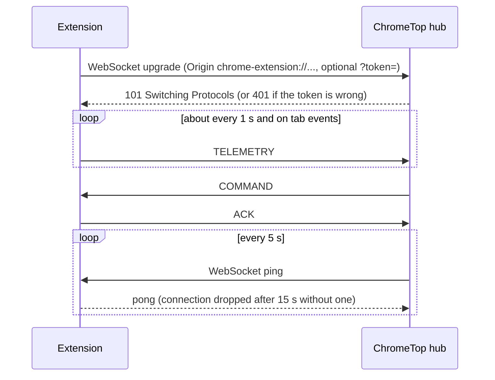

# Extension ⇄ ChromeTop Protocol

The extension connects to `ws://<addr>/ws[?token=<token>]` and exchanges JSON text frames.



## Frames

### `TELEMETRY` (extension → ChromeTop)

```json
{
  "type": "TELEMETRY",
  "sentAt": 1767000000000,
  "summary": { "mode": "EXTENSION", "totalTabs": 2, "totalCpuPercent": 18.4 },
  "tabs": [
    {
      "id": 10, "windowId": 1, "index": 0, "title": "Example", "url": "https://example.com",
      "status": "complete", "active": true, "cpuPercent": 12.1, "netBytesPerSec": 16384,
      "jsHeapUsedMb": 22.5, "estimatedMb": 60.0
    }
  ]
}
```

The full field list is defined by `TabInfo` and `Summary` in [`internal/protocol/messages.go`](../internal/protocol/messages.go).

### `COMMAND` (ChromeTop → extension)

```json
{ "type": "COMMAND", "action": "RELOAD", "tabId": 10, "windowId": 1, "requestId": "cmd-1767000000000" }
```

Actions: `FOCUS`, `CLOSE`, `RELOAD`, `DISCARD`, `MUTE`, `PIN`, `DUPLICATE`, `NEW_TAB` (uses `url`), `SYNC`.

### `ACK` (extension → ChromeTop)

```json
{ "type": "ACK", "requestId": "cmd-1767000000000", "ok": true, "detail": "Reloaded tab 10" }
```

## Limits

- Maximum frame size: 4 MiB.
- Only one extension connection is active; a new connection replaces the old one.
- The extension coalesces telemetry: at most one push in flight, at least 250 ms between pushes.
