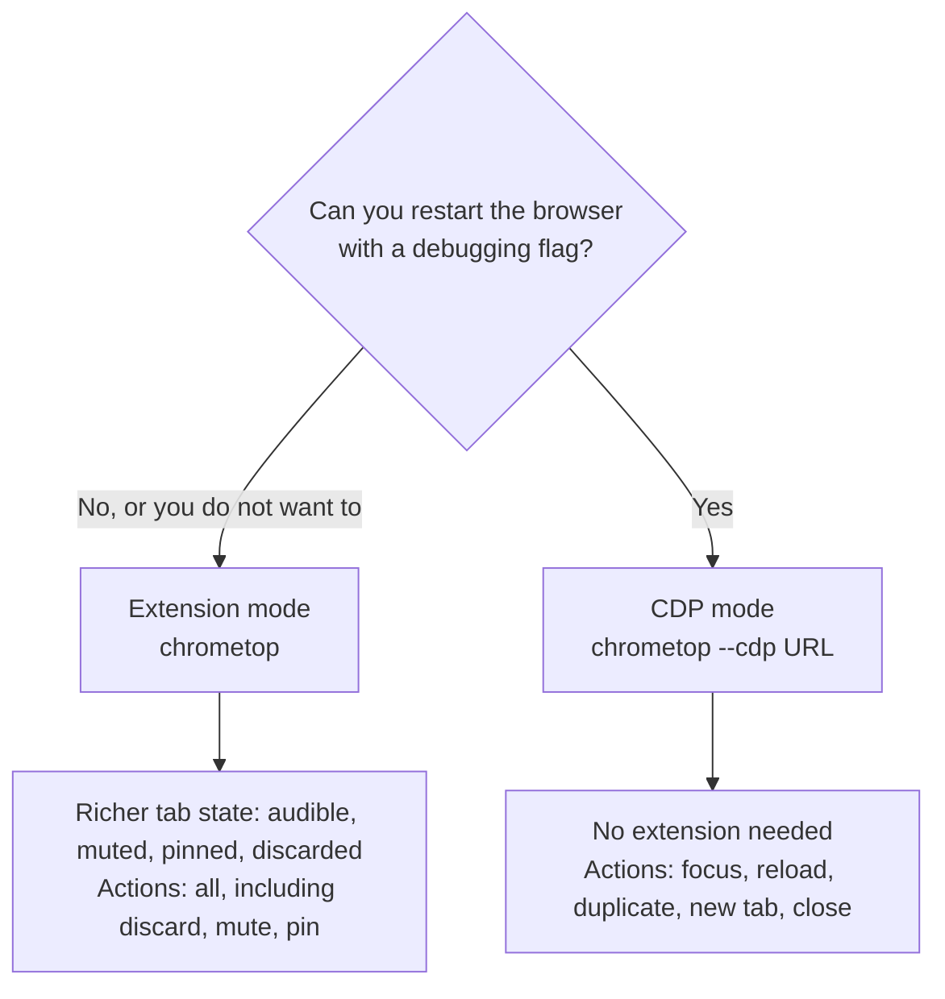

# Usage Guide

## Choosing a mode



| | Extension mode | CDP mode |
| :--- | :--- | :--- |
| Setup | Load the unpacked extension once | Launch the browser with `--remote-debugging-port` |
| Discard / mute / pin | Yes | No |
| Pinned, audible, muted state | Yes | No |
| Per-process PID and memory | When `chrome.processes` is available | No (heuristic memory) |
| Works with your normal profile | Yes | Needs a non-default `--user-data-dir` on Chrome 136+ |

## Extension mode

```bash
./chrometop --addr 127.0.0.1:9333 --token my-secret
```

If you set `--token`, enter the same token in the extension settings (`chrome.storage.local` key `authToken`; the endpoint key is `wsEndpoint`). Without a token only connections from `chrome-extension://` origins are accepted.

## CDP mode

```bash
brave --remote-debugging-port=9222 --remote-debugging-address=127.0.0.1 --user-data-dir=/tmp/brave-debug
./chrometop --cdp http://127.0.0.1:9222 --interval 1s
```

A higher `--interval` (for example `2s`) reduces load when you have many tabs.

## Everyday workflows

- **Find the heaviest tab:** the table starts sorted by CPU descending. Press `s` to switch to memory or heap.
- **Kill a runaway tab:** select it and press `x`.
- **Find a tab by name:** press `/`, type part of the title or URL, press `Enter`. `Esc` clears the filter.
- **Free memory without closing:** press `d` (extension mode) to discard the tab.
- **Inspect details:** press `i` to see PID, heap, DOM nodes and totals.

## Terminal requirements

- A terminal with Unicode and emoji support (Windows Terminal, iTerm2, GNOME Terminal, kitty, Alacritty, WezTerm).
- At least 60 columns by 12 rows. Wider terminals show a URL column.
- Resize freely: the layout adapts and always fills the window.
